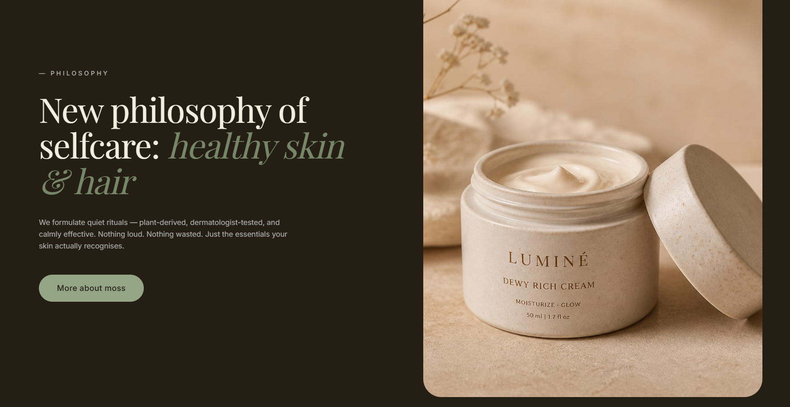
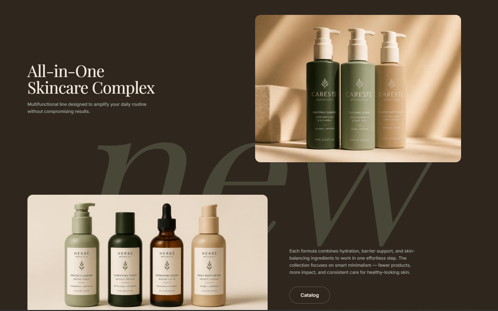

<div align="center">

  # 🌿 M O S S
  ### Luxury Botanical Skincare & High-End Wellness Experience

  <p align="center">
    <strong>A modern, editorial-grade skincare landing experience engineered with TanStack Start, React 19, TypeScript, and Tailwind CSS v4.</strong>
  </p>

  <p align="center">
    <a href="https://github.com/Komalgiri15/moss-landing-page">
      
    </a>
    <a href="https://tanstack.com/start">
      
    </a>
    <a href="https://tanstack.com/router">
      
    </a>
    <a href="https://tailwindcss.com/">
      
    </a>
    <a href="https://www.typescriptlang.org/">
      
    </a>
    <a href="https://vitejs.dev/">
      
    </a>
  </p>

  <p align="center">
    <a href="#-visual-showcase">Visual Showcase</a> •
    <a href="#-portfolio--recruiter-value">Portfolio Value</a> •
    <a href="#-key-features--page-sections">Page Sections</a> •
    <a href="#-design-system--editorial-aesthetics">Design System</a> •
    <a href="#-technical-architecture">Architecture</a> •
    <a href="#-quick-start">Quick Start</a> •
    <a href="#-available-for-hire">Hire Me</a>
  </p>

</div>

---

## 🌟 Executive Overview

**MOSS** is an editorial-first skincare landing page inspired by luxury apothecary and clean botanical wellness brands (such as Aesop, Furtuna Skin, and Le Labo). Designed and developed to demonstrate **advanced frontend engineering**, **creative art direction**, and **pixel-perfect UI execution**, this project shows how to translate luxury branding into a responsive, high-performance web experience.

Rather than relying on generic landing page templates or standard component blocks, MOSS features:
- **Warm, earthy OKLCH color science** with tailored espresso taupes (`--ink`), soft creams (`--cream`), and muted sage tones (`--moss`).
- **High-fashion editorial typography** combining `Playfair Display` with geometric sans `Inter`.
- **Custom viewport scroll reveals** powered by lightweight `IntersectionObserver` physics.
- **Asymmetric Bento Grids**, floating glassmorphism product badges, and organic wave section transitions.

---

## 📸 Visual Showcase

### 1. Editorial Product Gallery & Social Proof
> *High-contrast editorial header paired with interactive floating review badges, pill photo cutouts, and hero product staging.*

<p align="center">
  
</p>

- **Typography Mastery:** Oversized high-contrast serif headlines with responsive leading.
- **Floating Social Proof Badges:** Layered micro-cards with customer ratings, subtle drop-shadows, and hover physics.
- **Hero Product Focus:** Luminosity-blended studio product staging designed for luxury eCommerce conversion.

---

### 2. "Purely Beneficial" Bento Grid
> *Asymmetric 3-column layout highlighting brand pillars: Vegan sourcing, clinical backing, hydration, and clean formulation.*

<p align="center">
  
</p>

- **Adaptive Bento Architecture:** Asymmetric span cards (`col-span-2`, `col-span-1`) with auto-row scaling.
- **Split Content & Image Masking:** Text metadata on one half and gradient-masked botanical imagery on the other.
- **Iconography & Subtle Accents:** Lucide icons embedded in circular pill badges for instant visual scanning.

---

### 3. "All-in-One Skincare Complex" & Typographic Watermark
> *Ghost watermark typography layered beneath dual product compositions and interactive catalog CTAs.*

<p align="center">
  
</p>

- **Watermark Layering:** Subtle backdrop typography (*"new"*) rendered at fluid viewport sizes (`clamp(12rem, 35vw, 36rem)`) with zero layout interference (`pointer-events-none`).
- **Composition Stagger:** Staggered media layout separating the 3-bottle trio from the 4-step lineup with clean editorial narrative.
- **Branded Pill Actions:** Reusable outline and solid pill buttons engineered for effortless user interaction.

---

## 💼 Portfolio & Recruiter Value

> **Target Audience:** Freelance Clients, Frontend Engineering Leads, and Creative Directors looking for a developer who bridges the gap between **high-end design sensitivity** and **scalable code architecture**.

| Skill Area | Implementation in MOSS | Business & Engineering Impact |
| :--- | :--- | :--- |
| **Modern Stack & SSR Engine** | **TanStack Start & TanStack Router** with Nitro engine and React 19. | First-class routing, SEO-ready metadata headers, type-safe navigation, and zero client-side routing drift. |
| **Modern CSS & Tokenization** | **Tailwind CSS v4** with native `@theme inline` and custom **OKLCH** color values. | Uniform color perception across modern displays (P3 wide gamut); rapid design iteration without bloated stylesheets. |
| **Micro-Animations & Motion** | Custom `IntersectionObserver` reveal engine (`Reveal.tsx`) with staggered delays. | High-end, silky smooth scroll entrances without the heavy bundle size or CPU penalty of large external physics engines. |
| **Bespoke Layout Engineering** | Fluid `clamp()` typography, CSS Bento grids, and multi-layered glassmorphic depth. | Eliminates cookie-cutter template feel; produces custom high-converting branded experiences that stand out from competitors. |
| **Component Modularity** | Clean separation into semantic sections (`Hero`, `Benefits`, `Philosophy`, `ProductHighlight`, `AllInOne`, `InstaFeed`). | Plug-and-play architecture ready for headless CMS (Sanity, Strapi, Contentful) or Shopify storefront integration. |

---

## 🌿 Key Features & Page Sections

### 1. Full-Bleed Hero Landing (`Hero.tsx`)
- Full-viewport responsive height (`100svh`) featuring high-resolution botanical imagery.
- Screen-blend oversized brand display title (`moss`) scaling seamlessly across all screen sizes.
- Floating glassmorphism navigation bar with transparent-to-solid transitions and direct anchor navigation.

### 2. All-in-One Skincare Complex (`AllInOne.tsx`)
- Oversized typographic watermark background (*"new"*) adding depth without cluttering readability.
- Dual-stagger product showcase highlighting multifunctional formulas and minimal skincare routines.

### 3. 3D Product Highlight Spec (`ProductHighlight.tsx`)
- Floating frosted-glass spec card (`backdrop-blur-2xl`) featuring ingredient tags, localized pricing, and quick-action purchase button.
- Smooth hover scaling on product packaging rendering high tactile quality.

### 4. Brand Philosophy & Ritual (`Philosophy.tsx`)
- Editorial layout emphasizing the *"healthy skin & hair"* ethos.
- Warm textured ceramic jar imagery coupled with minimalist typographic storytelling.

### 5. Pure Care by Nature (`PureCare.tsx`)
- Multi-aspect ratio image composition showing minimalist product packaging in real-world lifestyle lighting.

### 6. Bento Grid Benefits (`Benefits.tsx`)
- Interactive cards showcasing 100% Vegan, Clinically Proven, Deep Hydration, and Clean Formulation.
- Subtle card zoom and gradient overlays on hover.

### 7. Editorial Product Gallery & Testimonials (`ProductGallery.tsx`)
- High-impact headline: *"Beauty That Feels as Good as It Looks"*.
- Layered social proof bubbles featuring verified 5-star customer reviews and circular model portraits.
- Hero product staging for *Aura Botanica Velvet Camellia Cream*.

### 8. Founder's Note (`Founder.tsx`)
- Authentic brand connection featuring portrait imagery and a personal message from founder Elena Rostova.

### 9. Curated Instagram Community Grid (`InstaFeed.tsx`)
- Asymmetric 2x2 and 1x1 photo grid replicating a live lifestyle social feed.
- Hover-activated branded overlays with smooth icon reveal transitions.

### 10. Organic Wave Transitions (`Wave.tsx`)
- SVG organic wave dividers replacing harsh geometric borders, maintaining a gentle, serene rhythm between sections.

### 11. Community Newsletter & Footer (`Newsletter.tsx` & `Footer.tsx`)
- Accessible email capture form with focused state styling.
- Comprehensive footer with secondary navigation, journal links, and copyright metadata.

---

## 🎨 Design System & Editorial Aesthetics

### Typography Hierarchy
- **Editorial Headings:** [`Playfair Display`](https://fonts.google.com/specimen/Playfair+Display) — Elegant, high-contrast serif giving the brand an artisanal, luxury magazine presence.
- **Body & Metadata:** [`Inter`](https://fonts.google.com/specimen/Inter) — Clean, legible modern sans with OpenType feature settings (`ss01`, `cv11`) for maximum readability.

### OKLCH Color Palette
The color scheme leverages modern **OKLCH color space** for rich tonal depth and consistent luminance across displays:

```css
/* Deep espresso taupe canvas */
--ink: oklch(0.24 0.02 70);

/* Elevated surface taupe */
--dark-surface: oklch(0.28 0.02 70);

/* Warm cream text and highlights */
--cream: oklch(0.95 0.02 85);

/* Fresh botanical sage accent */
--moss: oklch(0.70 0.05 130);

/* Sage hover state */
--moss-dark: oklch(0.60 0.05 130);
```

---

## 🏗 Technical Architecture

```text
moss-landing-page/
├── public/
│   ├── assets/               # Production image assets (cleansers, serums, portraits)
│   ├── favicon.svg           # Branded botanical SVG favicon
│   └── favicon.ico
├── src/
│   ├── assets/               # Brand logos, high-res photography, and UI captures
│   │   ├── screenshots/      # Organized high-res README showcase captures
│   │   └── logo.svg          # Vector brand logo
│   ├── components/
│   │   ├── Reveal.tsx        # IntersectionObserver scroll-trigger animation wrapper
│   │   ├── sections/         # Modular landing page sections
│   │   │   ├── Hero.tsx
│   │   │   ├── AllInOne.tsx
│   │   │   ├── ProductHighlight.tsx
│   │   │   ├── Philosophy.tsx
│   │   │   ├── PureCare.tsx
│   │   │   ├── Benefits.tsx
│   │   │   ├── ProductGallery.tsx
│   │   │   ├── Founder.tsx
│   │   │   ├── InstaFeed.tsx
│   │   │   └── Newsletter.tsx
│   │   └── ui/               # Reusable UI primitives
│   │       ├── Navbar.tsx
│   │       ├── Footer.tsx
│   │       ├── PillButton.tsx
│   │       ├── Wave.tsx
│   │       └── ...           # Accessible Radix primitives
│   ├── routes/
│   │   ├── __root.tsx        # HTML document shell, meta tags & web fonts
│   │   └── index.tsx         # Assembled landing page route
│   ├── router.tsx            # TanStack Router configuration
│   ├── start.ts              # TanStack Start entry point
│   ├── server.ts             # Nitro server handler
│   └── styles.css            # Tailwind CSS v4 directives & OKLCH design tokens
├── package.json
├── tsconfig.json
└── vite.config.ts
```

---

## ⚡ Quick Start

### Prerequisites
- **Node.js**: v18.0.0 or higher
- **Package Manager**: `npm` (or `bun` / `pnpm`)

### 1. Clone the repository
```bash
git clone https://github.com/Komalgiri15/moss-landing-page.git
cd moss-landing-page
```

### 2. Install dependencies
```bash
npm install
```

### 3. Run development server
```bash
npm run dev
```
Open [http://localhost:3000](http://localhost:3000) (or the Vite dev URL shown in your console) to view the application with instant Hot Module Replacement (HMR).

### 4. Build for production
```bash
npm run build
```

### 5. Preview production build
```bash
npm run preview
```

---

## 🛠 Available Scripts

| Command | Action |
| :--- | :--- |
| `npm run dev` | Starts Vite dev server with Hot Module Replacement |
| `npm run build` | Compiles optimized production bundle via Vite & Nitro |
| `npm run preview` | Locally serves the production build |
| `npm run lint` | Runs ESLint across all TypeScript and React files |
| `npm run format` | Formats codebase using Prettier |

---

## 🤝 Available for Freelance & Frontend Roles

Looking for a frontend developer who can transform design concepts into pixel-perfect, high-converting digital products?

### What I Bring to Your Team / Project:
- **Design-to-Code Precision:** 100% faithful implementation of Figma designs into clean, responsive React/TypeScript code.
- **Modern Architecture:** Deep experience with React 19, Next.js, TanStack Start/Router, and Tailwind CSS.
- **Conversion-Focused Aesthetics:** Creating bespoke luxury experiences that elevate brand prestige and drive user action.
- **Performance & Accessibility:** Semantic HTML, fast load times, and fluid micro-animations without bloated dependencies.

### Connect With Me:
- **GitHub:** [@Komalgiri15](https://github.com/Komalgiri15)
- **Role Openings:** Frontend Engineer • React Developer • UI/UX Developer • Freelance Web Consultant

---

<div align="center">
  <p>Crafted with care & precision • <strong>moss studio</strong> © 2025–2026</p>
</div>
